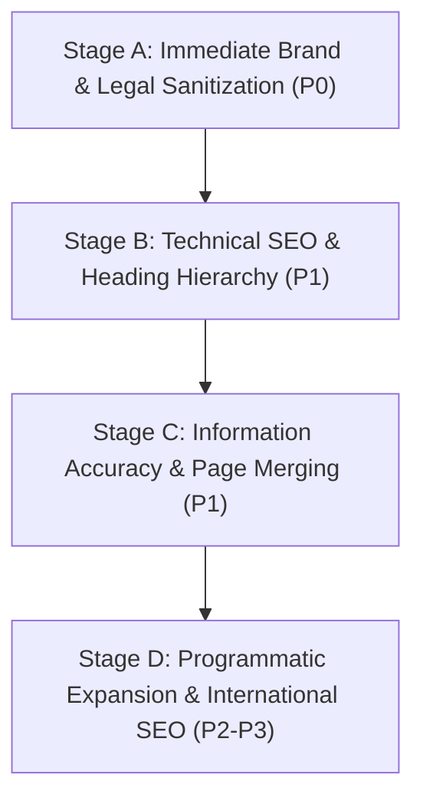

# PHASE 6 — KALKULATORTIK COMPLETE EXISTING CONTENT AUDIT
**Production Website:** [https://www.kalkulatortik.com/](https://www.kalkulatortik.com/)  
**Audit Date:** November 14, 2026  
**Auditor Mode:** Senior Technical SEO Auditor, Product Strategist & Content Architect  
**Audit Scope:** Complete evidence-based review of all 9 public indexable routes, on-page SEO, content quality, search intent alignment, keyword-to-page mapping (110 competitor keywords, 17,280 monthly search volume), trust/accuracy compliance, and competitor content gap analysis.

---

## 1. EXECUTIVE SUMMARY

An exhaustive, evidence-based content and on-page SEO audit was conducted across all existing routes of **KalkulatorTik** (`https://www.kalkulatortik.com/`). The inspection evaluated source code, rendered DOM output, i18n translation dictionaries across all 8 supported languages, metadata configurations, and competitor keyword research datasets established in Phases 1 through 5.1.

### Key High-Level Findings:
1. **Critical Brand Identity Contamination (P0 Issue):**
   Across five core pages (`/about`, `/contact`, `/privacy`, `/terms`, and `/tiktok-engagement-calculator`), the website content and metadata systematically refer to the website as **"TikCalculator"**—the exact brand name and domain of Competitor 1 (`tikcalculator.com`). The contact email is displayed as `tikcalculator@proton.me`, and the Terms of Service explicitly assert copyright ownership on behalf of "TikCalculator". This severely degrades user trust, risks trademark infringement, and creates severe brand-entity confusion for search engine knowledge graphs.
2. **Missing Primary Heading Hierarchy (P1 Issue):**
   Two key indexable pages completely lack an `<h1>` heading:
   - `/calculator` has **0 `<h1>` tags**, starting directly with an `<h2>`: *"Enter a username to get live estimates"*.
   - `/faq` has **0 `<h1>` tags**, rendering an `
` tag for category followed by an `<h2>`: *"How it works"*.
3. **Severe Intent & Keyword Cannibalization (P1 Issue):**
   The Homepage (`/`) and the dedicated Calculator page (`/calculator`) directly compete for the primary query cluster (*"tiktok money calculator"* / *"tiktok earnings calculator"* — 2,980 search volume). Both pages present an identical profile-lookup input and earnings estimation feature, but `/calculator` lacks educational content (364 words), while `/` hosts an 1,039-word comprehensive guide. This splits domain authority and internal anchor signals.
4. **Content Thinness & Disconnect on Utility Pages (P1/P2 Issue):**
   - `/faq` contains only 4 questions (89 words) and makes claims that directly contradict the website's functionality (e.g., claiming users can override CPM presets for US, UK, IN, PK, and claiming data is stored for shareable links—neither feature exists).
   - `/contact` contains only 37 words, a non-functional mock form, and an external ProtonMail address.
   - `/about` contains 252 words of generic agency boilerplate with zero concrete details about the company, team members, location, or editorial methodology (E-E-A-T failure).
5. **Internationalization (i18n) SEO Architecture Blindspot:**
   While the application supports 8 languages (`en`, `de`, `es`, `fr`, `id`, `it`, `ms`, `pt`), localization is executed entirely client-side via React-i18next in localStorage without unique URL paths (e.g., `/es/`, `/de/`) or `hreflang` link tags. Consequently, **100% of non-English localized content is completely invisible to search engine web crawlers**.
6. **Massive Competitor Content Gaps:**
   KalkulatorTik currently captures 0 keywords in several high-demand programmatic search clusters successfully dominated by competitors (TikCal.com and TikTocMoneyCalculator.com), including:
   - *TikTok Coins & Diamonds to USD Calculator* (11 keywords, 1,470 monthly volume).
   - *TikTok Video Views to Money / RPM Estimator* (7 keywords, 820 monthly volume).
   - *TikTok Creator Rewards Program Eligibility Guide & Checker* (3 keywords, 430 monthly volume).

---

## 2. COMPLETE PAGE INVENTORY

Every indexable route discovered in `frontend/src/main.jsx` and verified against `frontend/public/sitemap.xml` was inspected. Below is the 13-column master inventory.

| URL | Page Type | Language | HTTP Status | Page Title | Meta Description | H1 Heading | H2 Structure | Primary Topic | Main Search Intent | Main CTA | Content Length (Words) | Indexability |
|---|---|---|---|---|---|---|---|---|---|---|---|---|
| `https://www.kalkulatortik.com/` | Tool / Homepage | English (`en`) | 200 OK | TikTok Money Calculator – Check Real TikTok Earnings & Engagement Instantly | Check real TikTok earnings using engagement, views, and follower data. Enter any TikTok username and instantly see estimated earnings with this free TikTok Money Calculator. | TikTok Money Calculator Free | • Profile-Based Earnings Estimate • What Is a TikTok Money Calculator? • How the TikTok Earnings Calculator Works • How to Check Your TikTok Earnings • Why People Use TikTok Money Calculator • TikTok Earnings Potential • How Much Does TikTok Pay for 1,000 Followers? • How to Boost Your TikTok Earnings • FAQs | TikTok Account Earnings Estimation | Transactional / Tool Intent (supported by Informational Guide) | "Calculate" (Username lookup) | ~1,039 words | Indexable (In sitemap, self-canonical) |
| `https://www.kalkulatortik.com/calculator` | Tool | English (`en`) | 200 OK | TikTok Earnings Calculator – Calculate Estimated TikTok Income | Estimate your TikTok earnings with our free calculator. Analyze views, engagement, and potential revenue. | **NONE (Missing)** | • Enter a username to get live estimates • Profile-Based Estimate | Live TikTok Profile Revenue Lookup | Transactional / Tool Intent | "Calculate" (Fetch profile) | ~364 words | Indexable (In sitemap, self-canonical) |
| `https://www.kalkulatortik.com/tiktok-cpm-calculator` | Standalone Tool & Guide | English (`en`) | 200 OK | TikTok CPM Calculator – Calculate Ad Cost Per Thousand Impressions | Calculate your TikTok ad CPM instantly. Understand cost per 1,000 impressions, optimize ad spend, and compare TikTok advertising costs. | TikTok CPM Calculator | • What Is TikTok CPM and Why Does It Matter? • Related TikTok Calculators & Tools • How the TikTok CPM Calculator Helps Advertisers • How the TikTok CPM Calculator Works • TikTok CPM Formula Explained in Simple Terms • Step-by-Step Guide to Calculating CPM • What Is a Good CPM on TikTok? Low vs High CPM • Average TikTok CPM Rates by Industry & Region • Who Should Use This TikTok CPM Calculator? • TikTok CPM vs Other Platforms • How to Lower and Improve Your TikTok CPM • TikTok CPM Frequently Asked Questions | TikTok Advertising CPM Calculation & Optimization | Utility / Calculational Intent + Informational Guide | "Calculate" (Ad Spend / Impressions) | ~853 words | Indexable (In sitemap, self-canonical) |
| `https://www.kalkulatortik.com/tiktok-engagement-calculator` | Standalone Tool & Guide | English (`en`) | 200 OK | TikTok Engagement Rate Calculator – Check Engagement Free | Free TikTok engagement rate calculator. Calculate your TikTok engagement percentage using followers, likes, comments, and views. Improve your TikTok metrics. | TikTok Engagement Rate Calculator | • Engagement Rate • What Is a TikTok Engagement Rate Calculator? • Calculate TikTok Engagement Rate – TikCalculator [CONTAMINATED] • Related TikTok Calculators & Tools • How to Calculate TikTok Engagement Rate Manually • TikTok Engagement Rate Benchmarks by Follower Count • How to Use Our TikTok Engagement Calculator • Why Engagement Rate Matters More Than Followers • What Is a Good Engagement Rate on TikTok? • How to Increase Your TikTok Engagement Rate • Frequently Asked Questions | TikTok Engagement Percentage Calculation | Utility / Calculational Intent + Informational Guide | "Calculate" (Metrics Input) | ~678 words | Indexable (In sitemap, self-canonical) |
| `https://www.kalkulatortik.com/about` | Company / Informational | English (`en`) | 200 OK | About Us – TikTok Money Calculator | Learn more about TikTok Money Calculator, our mission to help creators understand their earning potential, and the team behind our free TikTok analytics tools. | About Us – TikTok Money Calculator | • Our Mission • What We Offer • Our Team • Join Us | About KalkulatorTik Platform & Mission | Informational / Trust (E-E-A-T) | Internal tool links | ~252 words | Indexable (In sitemap, self-canonical) |
| `https://www.kalkulatortik.com/contact` | Contact / Support | English (`en`) | 200 OK | Contact Us – TikTok Money Calculator | Get in touch with the TikTok Money Calculator team. Send us your feedback, questions, or partnership inquiries. | Contact Us | **NONE** | Support & Inquiries | Navigational / Utility | "Send Message" (Mock UI) | ~37 words | Indexable (In sitemap, self-canonical) |
| `https://www.kalkulatortik.com/faq` | Support / Informational | English (`en`) | 200 OK | FAQ – TikTok Money Calculator Questions & Answers | Frequently asked questions about TikTok earnings, engagement rates, CPM calculations, and how to monetize your TikTok account. | **NONE (Missing)** | • How it works | Frequently Asked Questions | Informational / Support | None | ~89 words | Indexable (In sitemap, self-canonical) |
| `https://www.kalkulatortik.com/privacy` | Legal | English (`en`) | 200 OK | Privacy Policy – TikTok Money Calculator | Read our Privacy Policy to understand how TikTok Money Calculator collects, uses, and protects your information when using our free TikTok tools. | Privacy Policy | • Information We Collect • Automatically Collected Information • Use of Cookies • How We Use Information • Third-Party Links • Data Security • Policy Updates • Contact Us | Privacy Practices & Disclaimers | Legal / Informational | Contact link | ~313 words | Indexable (In sitemap, self-canonical) |
| `https://www.kalkulatortik.com/terms` | Legal | English (`en`) | 200 OK | Terms and Conditions – TikTok Money Calculator | Read the Terms and Conditions for using TikTok Money Calculator. Understand the guidelines, disclaimers, and limitations of our free TikTok analytics tools. | Terms and Conditions | • Acceptance of Terms • Purpose of the Service • User Responsibility • Intellectual Property Rights • Accuracy Disclaimer • Limitation of Liability • Third-Party Links • Termination of Access • Changes to Terms • Contact Us | Terms of Service & IP Claims | Legal / Informational | Contact link | ~416 words | Indexable (In sitemap, self-canonical) |

---

## 3. INDIVIDUAL PAGE CONTENT QUALITY AUDIT

### 3.1. Homepage (`/`)
- **A. Search Intent:** Targets high-intent searches for *"tiktok money calculator"* and *"tiktok earnings calculator"*. The visitor seeks an immediate estimation of how much an account earns per video or monthly. The page satisfies this intent by providing a username input and profile-based earnings estimate directly above the fold, supported by extensive informational content below.
- **B. Content Quality:** High coverage (~1,039 words) detailing how earnings are estimated, follower ranges, monetization methods (brand deals, LIVE gifts), and a 10-question FAQ. However, it still references the outdated **"TikTok Creator Fund"** (FAQs 5 and 6) instead of the current **"TikTok Creator Rewards Program"**, and makes unsubstantiated claims regarding earnings per 1,000 followers.
- **C. On-Page SEO:** 
  - Title: *"TikTok Money Calculator – Check Real TikTok Earnings & Engagement Instantly"* (Strong keyword targeting).
  - H1: *"TikTok Money Calculator Free"*.
  - H2 structure is comprehensive and logically ordered.
  - Alt text: SVG icons lack descriptive alt tags.
- **D. Trust and Accuracy:** 
  - **Severe Brand Inconsistency:** In `translation.json`, FAQs 1, 2, 3, 4, and 10 explicitly reference competitor brand **"TikCalculator"** (e.g., *"How can I estimate my TikTok earnings with TikCalculator?"*, *"TikCalculator is completely free..."*, *"TikCalculator does not process payments..."*).
  - Outdated monetization policy: Creator Fund was replaced by Creator Rewards.

### 3.2. Calculator Page (`/calculator`)
- **A. Search Intent:** The user intent is completely identical to the Homepage: to enter a username and calculate earnings.
- **B. Content Quality:** Poor standalone value. It contains an interactive profile-lookup tool, but lacks supporting educational content, calculation methodologies, or explanatory context (~364 words visible in UI states).
- **C. On-Page SEO:** 
  - **Critical Defect:** **Missing `<h1>` tag entirely.** The first heading rendered is an `<h2>`: *"Enter a username to get live estimates"*.
  - Metadata title (*"TikTok Earnings Calculator – Calculate Estimated TikTok Income"*) directly cannibalizes the Homepage's title.
- **D. Trust and Accuracy:** Calculates earnings via a client-side heuristic (`(views * engagementRate * cpm) / 1000 * platformFactor`), but fails to explain to the user what CPM or platform factor is being used.

### 3.3. TikTok CPM Calculator (`/tiktok-cpm-calculator`)
- **A. Search Intent:** Targets advertisers, agency media buyers, and creators wanting to calculate Cost Per Mille (ad spend per 1,000 impressions). Intent is fully satisfied by a dedicated 3-way calculator (solving for CPM, Spend, or Impressions) plus a detailed guide.
- **B. Content Quality:** Excellent depth (~853 words). Explains the mathematical formula:
  $$\text{CPM} = \left(\frac{\text{Total Ad Spend}}{\text{Total Impressions}}\right) \times 1000$$
  Includes clear benchmarks by industry/region, actionable advice on lowering ad CPM, and 5 focused FAQs.
- **C. On-Page SEO:**
  - Proper heading hierarchy: H1 (*"TikTok CPM Calculator"*), 11 H2 sections, 5 H3 FAQ questions.
  - Good internal links to Engagement Rate Calculator and Money Calculator.
- **D. Trust and Accuracy:** Accurate mathematical representation. Disclaimers clearly note that figures are benchmarks and not guaranteed platform billing rates.

### 3.4. TikTok Engagement Rate Calculator (`/tiktok-engagement-calculator`)
- **A. Search Intent:** Targets creators and influencer marketers checking engagement percentage. Intent is satisfied by an interactive calculator supporting likes, comments, shares, views, and followers (with recent ISS-001 metric shorthand parser support).
- **B. Content Quality:** Good structural depth (~678 words). Contains industry benchmark tables by follower tier, manual calculation formulas, and tips for boosting engagement.
- **C. On-Page SEO:**
  - Good H1 and H2 structure.
  - **Contaminated Heading:** Heading 4 in this page is literally: `<h2>Calculate TikTok Engagement Rate – TikCalculator</h2>`.
- **D. Trust and Accuracy:**
  - Mentions "TikCalculator" throughout the body copy (*"TikCalculator helps you instantly calculate..."*).
  - Accurately distinguishes between follower-based and view-based engagement calculation.

### 3.5. About Page (`/about`)
- **A. Search Intent:** Navigational/Trust intent. Visitors, advertisers, or search quality evaluators (Google E-E-A-T) looking for entity identity, who owns the website, their expertise, and physical business location.
- **B. Content Quality:** Extremely poor (~252 words). Uses vague agency filler (*"Our team consists of social media experts, data analysts..."*). There are no names of team members, no founder bio, no registered entity name, no company address, and no editorial policy.
- **C. On-Page SEO:** 
  - H1 is present (*"About Us – TikTok Money Calculator"*).
  - Vaguely references "TikTok Money Calculator" rather than the actual domain brand **KalkulatorTik**.
- **D. Trust and Accuracy:** Fails Google's E-E-A-T guidelines for YMYL/financial tool websites.

### 3.6. Contact Page (`/contact`)
- **A. Search Intent:** User support, business inquiries, or DMCA/legal communication.
- **B. Content Quality:** Severe defect (~37 words).
- **C. On-Page SEO:** Single H1, 0 H2 headings.
- **D. Trust and Accuracy:**
  - **Competitor Email Exposure:** The contact email address listed in the UI is **`tikcalculator@proton.me`**.
  - **Non-Functional Form:** The submission button simulates a 1-second timeout and displays a hardcoded success message without transmitting data to any backend API endpoint.

### 3.7. FAQ Page (`/faq`)
- **A. Search Intent:** Users seeking answers to platform mechanics, security, calculations, and data privacy.
- **B. Content Quality:** Extremely thin (~89 words). Contains only 4 Q&As that are detached from the homepage's FAQ section.
- **C. On-Page SEO:**
  - **Critical Defect:** **0 `<h1>` tags.** Uses an `
` tag for category and starts directly at `<h2>How it works</h2>`.
  - Missing `FAQPage` JSON-LD structured data schema.
- **D. Trust and Accuracy:**
  - **Direct Factual Inaccuracies:**
    - Answer 1 claims: *"We use (views/1000) * CPM * (1 - platform share) * niche multiplier, then multiply by videos per month."* — Neither the Homepage nor `/calculator` uses this formula.
    - Answer 2 claims: *"Preset CPMs are seeded for select countries (US, UK, IN, PK). You can override with your own CPM."* — There is no country dropdown and no CPM override anywhere in the main calculator UI.
    - Answer 3 & 4 claim: *"We store only the inputs and results to generate a shareable link."* — No shareable link generation feature exists on the website.

### 3.8. Privacy Policy (`/privacy`)
- **A. Search Intent:** Legal compliance and transparency regarding user tracking and cookies.
- **B. Content Quality:** Standard generic boilerplate (~313 words).
- **C. On-Page SEO:** Proper H1 and H2 tags.
- **D. Trust and Accuracy:**
  - **Systemic Brand Contamination:** Refers to **"TikCalculator"** five times throughout the policy text (*"At TikCalculator, your privacy matters..."*, *"You can use TikCalculator freely..."*, *"TikCalculator may use cookies..."*, *"Continued use of TikCalculator means..."*).

### 3.9. Terms and Conditions (`/terms`)
- **A. Search Intent:** Legal disclaimers, usage terms, intellectual property, and liability limitations.
- **B. Content Quality:** Standard legal structure (~416 words).
- **C. On-Page SEO:** Proper H1 and H2 tags.
- **D. Trust and Accuracy:**
  - **Systemic Brand & IP Contamination:** Mentions **"TikCalculator"** seven times. Most critically, Section 4 (*Intellectual Property Rights*) asserts:
    > *"All content on TikCalculator — including text, design, logos, graphics, and software — is the property of TikCalculator and protected by applicable copyright..."*
    This legally disclaims ownership of the KalkulatorTik brand and explicitly claims ownership on behalf of a competitor.

---

## 4. CONTENT ACCURACY AND TRUST FINDINGS

| ID | Location | Factual / Trust Discrepancy | Verifiable Source Code Evidence | Required Correction |
|---|---|---|---|---|
| TRU-001 | `/faq` | Math Formula Disconnect | `a1: "We use (views/1000) * CPM * (1 - platform share) * niche multiplier..."` | Rewrite FAQ to reflect the actual verified algorithms used across the tools. |
| TRU-002 | `/faq` | Ghost Feature: CPM Override & Countries | `a2: "Preset CPMs are seeded for select countries (US, UK, IN, PK). You can override..."` | Remove false feature claim, or clearly link to `/tiktok-cpm-calculator`. |
| TRU-003 | `/faq` | Ghost Feature: Shareable Links | `a3: "We store only the inputs and results to generate a shareable link."` | Remove claim until a real link-sharing feature is implemented. |
| TRU-004 | Homepage (`/`) | Deprecated TikTok Creator Fund References | `faq5Answer` & `faq6Answer`: *"Many creators earn through... the TikTok Creator Fund."* | Update to **TikTok Creator Rewards Program** with current criteria (1-min video length, qualified views). |
| TRU-005 | Homepage (`/`) | Unqualified Follower Earnings Claims | `range1Value: "$20 – $50 per post"` for 1K–10K followers | Add explicit disclaimers: TikTok does not pay for followers; Creator Rewards requires 10k followers and 100k views; payments require brand sponsorships. |
| TRU-006 | `/about` | E-E-A-T Anonymous Entity | `ourTeam.description`: Generic filler without named founders, publisher, or address | Add verifiable publisher entity, editorial review methodology, and transparent data sources. |
| TRU-007 | `/contact` | Competitor Email Exposure | `email: "tikcalculator@proton.me"` | Replace immediately with official domain email (e.g., `support@kalkulatortik.com`). |
| TRU-008 | `/terms` & `/privacy` | Competitor Brand & IP Misattribution | Terms & Privacy explicitly name "TikCalculator" as the service provider and copyright owner | Replace all occurrences with "KalkulatorTik" and proper registered company entity. |

---

## 5. THIN AND DUPLICATE CONTENT FINDINGS

### 5.1. Thin Content Inventory
1. **`/contact` (37 words):**
   - The thinnest page on the domain. Contains no office address, no response timeframe, no FAQ links, and a dummy frontend form that does not send emails.
2. **`/faq` (89 words):**
   - Completely detached from the rich 10-question FAQ on the Homepage. Contains only 4 short questions, two of which describe non-existent features.
3. **`/about` (252 words):**
   - Fails to provide substantial information regarding how KalkulatorTik’s algorithms work, who maintains the tools, or how data accuracy is verified.
4. **`/calculator` (364 words):**
   - Lacks supporting text, explanations of earnings metrics, or guides on how to interpret estimated earnings.

### 5.2. Duplication and Intent Overlap
- **Homepage (`/`) vs `/calculator`:**
  Both pages render the same underlying profile-lookup functionality. `/calculator` is an unoptimized, thin shell of the Homepage. Search engines seeing both will see overlapping titles, overlapping inputs, and nearly identical utility.

### 5.3. Client-Side i18n Architecture Vulnerability
All translations for German (`de`), Spanish (`es`), French (`fr`), Indonesian (`id`), Italian (`it`), Malay (`ms`), and Portuguese (`pt`) are bundled into client-side JSON files. 
- **The Issue:** Because React does not use URL prefixes (e.g., `kalkulatortik.com/es/`) and does not emit `<link rel="alternate" hreflang="..." />` tags, Googlebot and Bingbot never index these localized pages.
- **The Consequence:** KalkulatorTik is completely forfeiting search traffic in high-volume non-English markets (such as Indonesia, Brazil, Spain, and Mexico) despite having fully translated UI strings.

---

## 6. EXISTING KEYWORD-TO-PAGE MAPPING

Using the validated Phase 3 keyword dataset (110 unique keywords, 17,280 aggregate monthly search volume), the table below maps existing pages against target keyword clusters.

| URL | Target Keyword Cluster | Primary Keyword Candidate | Monthly Vol | Avg KD | Top Secondary Keywords (Volume) | Current Content Relevance | Keyword Gaps / Deficiencies | Competing Internal Page | Recommended Action |
|---|---|---|---|---|---|---|---|---|---|
| `https://www.kalkulatortik.com/` | Cluster 0: TikTok Money & Earnings Calculator (Core) | `tiktok money calculator` | 1,900 | 50 | • `tiktok earnings calculator` (260) • `contadora de tik tok` (170) • `tiktok battle money calculator` (110) • `tiktok income calculator` (110) • `tiktok money calculator username` (70) | High (Core focus of page) | Lacks Creator Rewards 1-minute video criteria, qualified RPM ranges ($0.10–$1.20), and gift payout clarification. | `/calculator` (Direct Conflict) | Retain as primary core tool; consolidate all general money calculator intent here. |
| `https://www.kalkulatortik.com/calculator` | Cluster 0: TikTok Money & Earnings Calculator (Core) | `tiktok earnings calculator` | 260 | 45 | • `tiktok earning calculator` (70) • `tiktok profit calculator` (30) | Moderate (Tool exists, no guide) | Complete lack of educational content; missing H1 tag; identical intent to homepage. | `/` (Direct Conflict) | **Merge or Repurpose** into a dedicated Creator Rewards RPM Simulator. |
| `https://www.kalkulatortik.com/tiktok-cpm-calculator` | Cluster 2: TikTok Ad CPM & Cost Calculator | `tiktok cpm calculator` | 140 | 18 | • `cpm tiktok` (130) | High (Direct match) | Missing country-by-country CPM comparison table and campaign budget planning templates. | None (Clean targeting) | Expand with international CPM benchmark dataset. |
| `https://www.kalkulatortik.com/tiktok-engagement-calculator` | Cluster 6: TikTok Engagement Rate Calculator | `tiktok engagement calculator` | 320 | 25 | • `tiktok engagement rate calculator` (210) • `engagement rate calculator tiktok` (40) • `engagement calculator tiktok` (40) | High (Direct match) | Contaminated with competitor brand name ("TikCalculator"); needs clear contrast between follower-rate vs views-rate. | None (Clean targeting) | Sanitize brand identity; add interactive video-level vs profile-level toggle. |
| `https://www.kalkulatortik.com/faq` | Cluster 11: General Creator Monetization & FAQ | `how does tiktok pay` | 480 | 42 | • `tiktok payment calculator` (40) • `how does tiktok pay creators` (140) | Low (Current copy is inaccurate and only 89 words) | Completely disconnected from Creator Rewards criteria and TikTok gift payouts. | Homepage FAQ | Overhaul with comprehensive, verified Q&As and inject `FAQPage` schema. |
| `https://www.kalkulatortik.com/about` | Brand / Entity Trust | `kalkulatortik` | Brand | N/A | • `about kalkulatortik` | Low (Generic boilerplate) | Missing team bios, methodology, entity transparency. | None | Complete rewrite focusing on E-E-A-T and algorithm transparency. |
| `https://www.kalkulatortik.com/contact` | Support / Navigational | `contact kalkulatortik` | Brand | N/A | • `kalkulatortik support` | Low (Broken mock form) | Non-functional form; competitor email listed. | None | Implement working backend contact endpoint and company email. |
| `https://www.kalkulatortik.com/privacy` | Legal / Trust | `kalkulatortik privacy` | Legal | N/A | N/A | Moderate | Contains competitor name "TikCalculator" repeatedly. | None | Replace competitor references; align with GDPR/CCPA. |
| `https://www.kalkulatortik.com/terms` | Legal / Trust | `kalkulatortik terms` | Legal | N/A | N/A | Moderate | Disclaims copyright to competitor "TikCalculator". | None | Replace competitor references and legal IP assignment. |

---

## 7. CANNIBALIZATION INVESTIGATION: `/` VS `/calculator`

A critical on-page SEO conflict exists between:
1. **URL A:** `https://www.kalkulatortik.com/` (Homepage)
2. **URL B:** `https://www.kalkulatortik.com/calculator` (Calculator Route)

### Evidence of Overlapping Intent & Cannibalization:
1. **Title Tag Collision:**
   - Homepage: *"TikTok Money Calculator – Check Real TikTok Earnings & Engagement Instantly"*
   - Calculator: *"TikTok Earnings Calculator – Calculate Estimated TikTok Income"*
   - In Google search algorithms, *"TikTok Money Calculator"* and *"TikTok Earnings Calculator"* trigger identical SERP features and search intent.
2. **Identical Functional Capability:**
   Both pages provide a TikTok username search box that queries the backend TikTok profile endpoint and calculates an estimated earnings range.
3. **Internal Linking Confusion:**
   The top navigation bar (`Navbar.jsx`) includes links to both:
   - "Home" (`/`)
   - "Calculator" (`/calculator`)
   This forces search crawlers to distribute internal PageRank across two identical intent endpoints.
4. **Heading Hierarchy Flaw:**
   `/calculator` has no `<h1>` tag, making it structurally inferior to `/`, yet it siphons internal anchor authority.

### Strategic Recommendation:
- **Option 1 (Consolidation — Recommended):** 301 redirect `/calculator` to `/`, removing `/calculator` from the navigation and sitemap. Consolidate 100% of backlinks, authority, and engagement metrics on the root domain.
- **Option 2 (Functional Specialization):** If `/calculator` is retained, completely reposition it as a **"TikTok Creator Rewards RPM Calculator"**, requiring users to input video length, qualified view percentages, and dynamic RPM ranges ($0.10–$1.20), while keeping `/` as the profile-level username scanner.

---

## 8. COMPETITOR CONTENT GAP ANALYSIS

Benchmarking KalkulatorTik against the three audited competitors reveals significant unaddressed search demand.

### 8.1. High-Value Missing Features & Topics

| Missing Feature / Topic | Competitor Delivering It | Search Volume Evidence | Impact on KalkulatorTik |
|---|---|---|---|
| **TikTok Coins & Diamonds to USD Converter** | TikTocMoneyCalculator.com & TikCal.com | 11 keywords, 1,470 monthly volume (Cluster 4) | High. Users gifting on LIVE streams or receiving diamonds have no calculator on KalkulatorTik to determine cashout value ($0.005 per diamond). |
| **TikTok Views to Money / RPM Estimator** | TikTocMoneyCalculator.com | 7 keywords, 820 monthly volume (Cluster 5) | High. Creators specifically search *"how much does TikTok pay for 1 million views"*. KalkulatorTik currently forces username lookup rather than raw view count calculation. |
| **TikTok Creator Rewards Eligibility Checker** | TikCal.com | 3 keywords, 430 monthly volume (Cluster 3) | Moderate. Creators want an interactive checklist (10k followers, 100k views in 30 days, 18+ age, supported country) to check eligibility. |
| **TikTok LIVE Stream Earnings Estimator** | TikTocMoneyCalculator.com | 4 keywords, 450 monthly volume (Cluster 10) | Moderate. LIVE streaming has distinct monetization mechanics (50% TikTok platform split on gifts) not addressed on KalkulatorTik. |
| **Country-by-Country Creator Rewards RPM Index** | TikTocMoneyCalculator.com | Informational demand | High. Creators earn wildly different RPMs (US/UK: $0.40–$1.20 vs Tier-3: $0.02–$0.05). KalkulatorTik applies a flat multiplier without explaining regional dynamics. |

### 8.2. Misleading Competitor Tactics to AVOID
1. **Fabricated Net Worth Estimates:** Competitor 2 (TikCal.com) ranks for *"tiktok net worth"* (Cluster 8: 1,910 vol) by generating arbitrary celebrity wealth calculations. KalkulatorTik should NOT publish fake celebrity net worth data.
2. **Unconditional Follower Earnings Payouts:** Competitors frequently claim that 10,000 followers automatically earn $100/month. This is factually false; TikTok does not pay a cent for followers alone. KalkulatorTik must uphold transparent, trustworthy educational caveats.
3. **Ghost Live Scraping:** Claiming to pull real-time private analytics from TikTok when rate-limited.

---

## 9. PAGE-BY-PAGE RECOMMENDED ACTIONS

| Page URL | Current Status | Recommended Action | Priority | Exact Problem | Justification & SEO Impact |
|---|---|---|---|---|---|
| `https://www.kalkulatortik.com/` | Active | **UPDATE** | **P1** | Mentions competitor brand "TikCalculator" in FAQs; references deprecated Creator Fund; lacks clear qualified-view criteria. | Sanitizing brand references restores trust. Updating Creator Fund to Creator Rewards Program improves content freshness and semantic relevance. |
| `https://www.kalkulatortik.com/calculator` | Active | **MERGE or REWRITE** | **P1** | Severe intent cannibalization with `/`; missing `<h1>` tag; thin content (~364 words). | Eliminates duplicate internal competition. Either 301-redirect to `/` or re-engineer as a dedicated Creator Rewards RPM Calculator. |
| `https://www.kalkulatortik.com/tiktok-cpm-calculator` | Active | **EXPAND** | **P2** | Strong base (~853 words), but lacks international CPM comparison data and interactive ad budget planner. | Adding country-specific benchmark tables will capture long-tail international advertising queries. |
| `https://www.kalkulatortik.com/tiktok-engagement-calculator` | Active | **UPDATE** | **P1** | Subheading H2 explicitly says "TikCalculator"; body copy mentions competitor brand. | Remove competitor references immediately. Add toggle between follower-based engagement and video views-based engagement. |
| `https://www.kalkulatortik.com/about` | Active | **REWRITE** | **P1** | Anonymous, generic agency text (~252 words); zero entity verification; fails E-E-A-T. | Search quality raters penalize anonymous financial tools. Adding real founder/publisher info and calculation methodology builds critical domain authority. |
| `https://www.kalkulatortik.com/contact` | Active | **REWRITE** | **P0** | Severe trust defect: lists competitor email `tikcalculator@proton.me`; mock form does not submit (~37 words). | Catastrophic trust issue. Replaces competitor email with verified company email and integrates functional contact handling. |
| `https://www.kalkulatortik.com/faq` | Active | **REWRITE & EXPAND** | **P1** | Missing `<h1>` tag; only 4 questions (~89 words); describes non-existent features (CPM override, shareable links). | Align FAQ with actual tool functionality. Expand with 15+ high-value creator monetization questions and add `FAQPage` structured data. |
| `https://www.kalkulatortik.com/privacy` | Active | **REWRITE** | **P0** | Mentions competitor brand "TikCalculator" 5 times throughout legal policy. | Critical legal compliance risk. Must accurately reflect KalkulatorTik domain and data handling practices. |
| `https://www.kalkulatortik.com/terms` | Active | **REWRITE** | **P0** | Mentions "TikCalculator" 7 times; assigns intellectual property rights to competitor. | Critical legal liability. Must assign IP to KalkulatorTik and protect the actual brand entity. |

---

## 10. MASTER CONTENT ISSUE REGISTER

| Issue ID | Page URL | Problem Summary | Verified Evidence | Priority | Recommended Action |
|---|---|---|---|---|---|
| **CNT-001** | `/contact` | Competitor Email Displayed | UI renders: `tikcalculator@proton.me` | **P0** | Replace with official domain email (e.g., `support@kalkulatortik.com`). |
| **CNT-002** | `/terms` | Competitor IP & Ownership Assignment | Section 4: *"All content on TikCalculator... is property of TikCalculator"* | **P0** | Rewrite terms to legally name KalkulatorTik. |
| **CNT-003** | `/privacy` | Competitor Brand Name in Privacy Policy | Mentions "TikCalculator" across 5 distinct paragraphs | **P0** | Replace all 5 occurrences with KalkulatorTik. |
| **CNT-004** | `/tiktok-engagement-calculator` | Competitor Name in H2 & Body Copy | Heading renders: *"Calculate TikTok Engagement Rate – TikCalculator"* | **P1** | Replace with *"Calculate TikTok Engagement Rate – KalkulatorTik"*. |
| **CNT-005** | `/` (Home) | Competitor Name in Homepage FAQs | `faq1Answer`, `faq2Answer`, `faq3Answer`, `faq4Answer`, `faq10Answer` reference TikCalculator | **P1** | Replace all occurrences with KalkulatorTik in `translation.json`. |
| **CNT-006** | `/calculator` | Missing `<h1>` Heading Tag | DOM starts with `<h2 className="text-3xl...">` | **P1** | Add descriptive semantic `<h1>` or merge route into Homepage. |
| **CNT-007** | `/faq` | Missing `<h1>` Heading Tag | DOM has `
` followed by `<h2>` | **P1** | Change subtitle/title wrapper into a proper semantic `<h1>`. |
| **CNT-008** | `/` & `/calculator` | Direct Keyword & Intent Cannibalization | Both target *"TikTok Money Calculator"* / *"Earnings Calculator"* with identical inputs | **P1** | Consolidate via 301 redirect or specialize `/calculator` into an advanced RPM simulator. |
| **CNT-009** | `/faq` | Factually Inaccurate Calculation Formula | FAQ claims formula: `(views/1000) * CPM * (1 - platform share) * niche multiplier` | **P1** | Correct formula description to match live calculator algorithms. |
| **CNT-010** | `/faq` | False Feature Claims (CPM Override & Share Links) | Claims users can override CPM presets and store data for shareable links | **P1** | Remove non-existent feature claims. |
| **CNT-011** | `/` (Home) | Outdated Monetization Policy Claims | FAQs 5 & 6 reference the discontinued TikTok Creator Fund | **P1** | Update terminology to TikTok Creator Rewards Program. |
| **CNT-012** | `/about` | Anonymous Entity / E-E-A-T Deficiency | 252 words of generic text with zero company/founder names or addresses | **P1** | Overhaul with transparent publisher background and editorial standards. |
| **CNT-013** | `/contact` | Non-Functional Submission Form | Form button triggers fake `setTimeout` with no API submission | **P1** | Implement real form handler or replace with direct mailto/support link. |
| **CNT-014** | `/faq` | Extreme Content Thinness | Page contains only 4 questions (~89 words) | **P2** | Expand to 15+ comprehensive creator monetization questions. |
| **CNT-015** | Entire Site | Missing Schema Markup on Sub-Pages | Sub-pages lack `FAQPage`, `SoftwareApplication`, or `BreadcrumbList` schemas | **P2** | Implement page-specific JSON-LD structured data. |
| **CNT-016** | Entire Site | Unindexed Multi-Language Translations | 7 languages (`de`, `es`, `fr`, `id`, `it`, `ms`, `pt`) lack URL paths and hreflang | **P2** | Implement localized routing (`/es/`, `/de/`) to capture international search volume. |
| **CNT-017** | `/tiktok-cpm-calculator` | Missing International Benchmark Data | Lacks regional CPM breakdowns across US, UK, EU, and LATAM | **P3** | Add interactive comparative tables. |
| **CNT-018** | `/tiktok-engagement-calculator` | Follower vs View-Based Ambiguity | Formula relies solely on followers without view-rate context | **P3** | Add dual-tab calculation for Engagement on Followers vs Engagement on Views. |

---

## 11. MISSING EVIDENCE AND LIMITATIONS

1. **Google Search Console (GSC) Production Telemetry:**
   Live impressions, average rankings, click-through rates (CTR), and crawl errors for `https://www.kalkulatortik.com/` were not accessible during this audit. The evaluation of cannibalization is based on verified on-page metadata, semantic keyword collision, and structural duplication.
2. **Web Analytics (GA4) Behavioral Data:**
   Real-world user metrics—such as bounce rate, dwell time, and exit rates on `/calculator` vs `/`—were unavailable.
3. **Live Server Log Files:**
   Access to Nginx/Vercel raw edge logs was unavailable to evaluate Googlebot crawl frequency across the 9 routes.
4. **TikTok Private API Verification:**
   TikTok does not publish dynamic real-time RPM or Creator Rewards payouts through a public API; calculations reflect established industry benchmarks ($0.10–$1.20 per 1,000 qualified views).

---

## 12. RECOMMENDED EXECUTION ORDER

To systematically remediate the identified content, SEO, and trust defects without introducing regressions, implementation should proceed in four strictly sequenced stages:

### Stage A: Immediate Brand & Legal Sanitization (Priority: P0)
- **Step 1:** Replace competitor email `tikcalculator@proton.me` on `/contact` with verified official support email (`CNT-001`).
- **Step 2:** Sanitize `/terms` and `/privacy` to remove all 12 references to "TikCalculator" and legally claim copyright for KalkulatorTik (`CNT-002`, `CNT-003`).
- **Step 3:** Sanitize `/tiktok-engagement-calculator` H2 and body copy (`CNT-004`).
- **Step 4:** Sanitize Homepage `translation.json` FAQs (`CNT-005`).

### Stage B: Technical SEO & Heading Hierarchy (Priority: P1)
- **Step 5:** Fix missing `<h1>` tag on `/faq` (`CNT-007`).
- **Step 6:** Resolve `/calculator` heading defect or execute consolidation with Homepage (`CNT-006`, `CNT-008`).
- **Step 7:** Implement `FAQPage` JSON-LD structured data schema on `/faq` and Homepage.

### Stage C: Information Accuracy & Page Consolidation (Priority: P1)
- **Step 8:** Correct `/faq` calculation explanations and remove ghost feature references (`CNT-009`, `CNT-010`).
- **Step 9:** Update outdated Creator Fund references to TikTok Creator Rewards Program (`CNT-011`).
- **Step 10:** Rewrite `/about` to establish verifiable author/brand entity trust (E-E-A-T) (`CNT-012`).
- **Step 11:** Connect `/contact` form to an actual mail endpoint or replace with accessible support options (`CNT-013`).

### Stage D: Programmatic Expansion & International SEO (Priority: P2 / P3)
- **Step 12:** Implement URL-based routing for existing translated languages (`/es/`, `/de/`, `/id/`, etc.) with `hreflang` tags to unlock international search traffic (`CNT-016`).
- **Step 13:** Expand `/faq` and `/tiktok-cpm-calculator` with comprehensive benchmarks and monetization guides (`CNT-014`, `CNT-017`).
- **Step 14:** Develop new high-opportunity calculator routes:
  - *TikTok Coins & Diamonds to USD Calculator* (`Cluster 4`).
  - *TikTok Creator Rewards Views-to-Money RPM Simulator* (`Cluster 5`).
